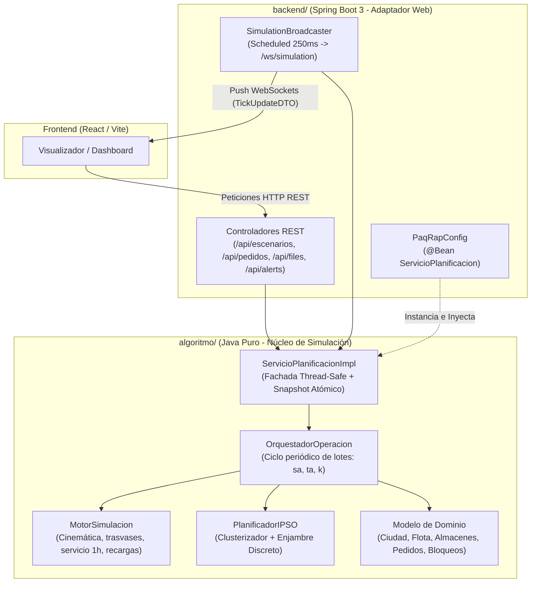

# Guía Maestra de Estudio: Backend y Motor de PaqRap (DP1)

> Documento de síntesis técnica para preparación, comprensión y defensa del backend y del motor de simulación/planificación de **PaqRap**.

---

## 1. Arquitectura General y Módulos

El repositorio está estructurado como un proyecto multimódulo Maven (`pom.xml`) compuesto por dos capas principales que separan la infraestructura web del núcleo algorítmico:



### Características Fundamentales
1. **Arquitectura In-Memory Stateful (Sin BD):**
   - No utiliza PostgreSQL, MySQL ni JPA/Hibernate para la simulación.
   - Todo el estado vive en memoria dentro del bean singleton `ServicioPlanificacion`, eliminando latencias de disco y bloqueos de base de datos durante la simulación acelerada.
2. **Desacoplamiento Absoluto:**
   - El módulo `algoritmo/` es Java estándar puro (sin ninguna anotación de Spring Framework ni dependencias web).
   - El módulo `backend/` actúa como adaptador liviano (Spring Web, WebSockets y Jackson).

---

## 2. Datos Hardcodeados vs. Datos Dinámicos

| Elemento | Origen / Definición | ¿Hardcodeado? | Ubicación en Código | Modificable en Caliente |
| :--- | :--- | :---: | :--- | :---: |
| **Grilla / Mapa** | $70 \times 50$ manzanas, origen $(0,0)$, 1 km/cuadra | **SÍ** | `PaqRapConfig.java` (`ciudad()`) | No |
| **Almacenes** | Central $(27,14)$ (cap. $\infty$), Intermedios $(12,38)$ y $(57,27)$ con stock inicial de 1000 | **SÍ** | `PaqRapConfig.java` (`almacenes()`) | No (stock varía por operación y recarga diaria) |
| **Flota Inicial** | 10 Autos (`TA`), 15 Motos (`TM`), 12 Bicis (`TB`) arrancando a las 07:00 en $(27,14)$ | **SÍ** | `PaqRapConfig.java` (`flota()`) | **SÍ** (vía `/solicitudes`) |
| **Parámetros Vehículo** | Capacidades (24, 8, 4), Velocidades (40, 25, 12 km/h), Costos (8, 6, 3 S/./km) | **SÍ** | `PaqRapConfig.java` (`tiposVehiculo()`) | **SÍ** (`CAMBIO_VELOCIDAD`, `CAMBIO_CAPACIDAD`) |
| **Reglas Operativas** | Turno 8h, inicio 07:00, servicio 1h, trasvase 0.5h, máx. 2 paradas por ruta | **SÍ** | `PaqRapConfig.java` (`configuracionOperacion()`) | No |
| **Algoritmo Activo** | `TipoAlgoritmo.IPSO` con sus hiperparámetros | **SÍ** | `PaqRapConfig.java` (`servicioPlanificacion()`) | Requiere reinicio o ajuste en configuración |
| **Pedidos** | Fechas de ingreso, cliente, coordenadas destino, cantidad, fecha límite SLA | **NO** | `ventas.YYYYMM.txt` | Dinámico por archivo |
| **Bloqueos** | Tramos de calle inhabilitados y ventana temporal de vigencia | **NO** | `bloqueo.YYMM.txt` | Dinámico por archivo |
| **Mantenimientos** | Ventanas de mantenimiento preventivo de unidades | **NO** | `mant.preventivo.*.txt` | Dinámico por archivo |

---

## 3. Capa Web y Controladores (`backend/`)

1. **`PaqRapConfig.java`:**
   - Raíz de composición de Spring. Cablea la ciudad, almacenes, flota y el singleton `ServicioPlanificacionImpl`.
2. **`SimulacionController.java`:**
   - `POST /api/escenarios`: Inicia o se une a una ejecución activa (`DIA_A_DIA`, `CINCO_DIAS`, `COLAPSO`).
   - `GET /api/escenarios/activa`: Permite que nuevas pestañas o recargas del navegador se sincronicen sin reiniciar la corrida.
   - `POST /api/escenarios/{id}/solicitudes`: Inyecta averías mecánicas (`INYECCION_AVERIA`) o cambios de flota en tiempo de ejecución.
   - `POST /api/escenarios/{id}/pausar`, `/reanudar`, `/detener`.
   - `GET /api/escenarios/{id}/reporte`: Retorna el balance de métricas finales tras la finalización.
3. **`ConsultaController.java`:**
   - `GET /api/estado-operacion`: Retorna la última instantánea atómica publicada.
   - `GET /api/pedidos`: Lista y filtra el estado de los pedidos.
4. **`IngestaController.java`:**
   - Endpoints multipart `/api/files/*` para carga manual de pedidos, bloqueos y mantenimientos.
5. **`AlertasController.java`:**
   - `GET /api/alerts`: Combina incidencias activas (bloqueos, averías) con alertas predictivas de pedidos a menos de 1 hora de romper su SLA.
6. **`SimulationBroadcaster.java` y `SimulationWebSocketHandler.java`:**
   - Tarea programada `@Scheduled(fixedRate = 250)` (4 veces por segundo).
   - Detecta si el orquestador avanzó el reloj (`marcaTiempoActual`). Si hay oyentes conectados, empuja un mensaje `TickUpdateDTO("LOTE_ACTUALIZADO", estado, alertas)` al canal `/ws/simulation`.

---

## 4. El Corazón del Motor: `OrquestadorOperacion` y `MotorSimulacion`

### Los Parámetros Matemáticos Clave
- **$s_a$ (Intervalo de Planificación):** Minutos reales entre cada cálculo de lote.
- **$t_a$ (Presupuesto de Cómputo):** Segundos reales máximos permitidos al algoritmo para entregar rutas ($s_a > t_a > 0$).
- **$k$ (Factor de Aceleración):** Escala temporal del simulador:
  $$\Delta t_{\text{simulado}} = \left(\frac{s_a}{60}\right) \times k \quad \text{[horas]}$$

### Parámetros por Escenario
| Escenario | Propósito | $s_a$ | $t_a$ | $k$ | Avance Simulado por Lote |
| :--- | :--- | :---: | :---: | :---: | :---: |
| **`DIA_A_DIA`** | Operación en tiempo real | 5.0 min | 60.0 s | 1 | 5 minutos |
| **`CINCO_DIAS`** | Evaluación rápida de 5 días | 0.5 min (30 s) | 20.0 s | 2 | 1 hora |
| **`COLAPSO`** | Prueba de estrés de demanda | 0.25 min (15 s)| 10.0 s | 4 | 1 hora |

---

### Ciclo de Ejecución de un Lote (`ejecutarSiguienteLote`)

En cada *tick* periódico ocurren 7 pasos atómicos:
1. **Carga Bajo Demanda:** `CargadorRecursos` asegura en memoria los pedidos del mes actual y los bloqueos/mantenimientos del mes actual y siguiente.
2. **Procesamiento de Solicitudes:** Aplica averías programadas, reanuda unidades reparadas y actualiza parámetros de flota modificados.
3. **Continuidad de Rutas:**
   - Si un vehículo está físicamente **`ENTREGANDO`** (atención al cliente de 1 hora), su ruta se **protege y conserva**.
   - Si la ruta sigue siendo factible y no aparecieron bloqueos en su trayectoria, se **mantiene** para evitar que los vehículos zigzagueen.
   - Si la ruta fue cortada por un bloqueo nuevo o avería, se abandona y sus pedidos pendientes regresan a la cola general.
4. **Filtrado Temporal de Pedidos:** Solo compiten aquellos pedidos con `fechaIngreso <= relojSimuladoActual`.
5. **Invocación al Algoritmo:** `planificador.planificarRutas(contextoDelLote)` genera nuevas rutas para los vehículos disponibles.
6. **Simulación Física (`MotorSimulacion`):**
   - Avanza la posición $(x,y)$ de cada vehículo según su velocidad y trayectorias A*/Manhattan.
   - Gestiona el tiempo de servicio de entrega (1 hora por cliente).
   - Descuenta stock de almacenes intermedios al despachar.
7. **Cierre y Verificación:**
   - Si el reloj cruzó las 00:00 h, reabastece los almacenes intermedios a 1000 unidades.
   - **Criterio de Parada Firme:** Si algún pedido supera su fecha límite sin haber sido entregado, el estado pasa a `INCUMPLIDA` y la simulación se detiene inmediatamente (`DETENIDA_POR_INCUMPLIMIENTO`).
   - Dispara `alCerrarLote()` para actualizar la instantánea inmutable que leen el WebSocket y las APIs REST.

---

## 5. El Algoritmo Activo: IPSO (Improved Particle Swarm Optimization)

El sistema utiliza una arquitectura **"Cluster-First, Route-Second"** (Primero Agrupar, Luego Rutear):

```
[ ContextoProblema ]
        │
        ▼
 Fase 1: ClusterizadorPedidos.java
   - Ordena pedidos por urgencia SLA.
   - Asigna vehículo disponible por capacidad (Bici -> Moto -> Auto).
   - Restringe máximo 2 paradas por ruta.
   - Asigna almacén de origen más cercano con stock.
        │
        ▼
 Fase 2: IPSOOptimizador.java (Metaheurística Discreta)
   - Población: N = 40 partículas.
   - Iteraciones: T = 300 (con detección de estancamiento temprano).
   - Posición (X): Permutación del orden de paradas a visitar.
   - Velocidad (V): Lista de operaciones de intercambio (Swaps).
   - Ecuación de Movimiento:
       V(t+1) = Inercia(w=0.35) + Memoria_Cognitiva(c1=1.5, Pbest) + Influencia_Social(c2=1.5, Gbest)
   - Operador de Cruce (Pc = 0.30): Hibridación para escapar de óptimos locales.
   - Función Objetivo (Fitness): Distancia × Costo/km + Penalización Infinita por violación de SLA.
        │
        ▼
 [ List<Ruta> final asignada a la flota ]
```

### ¿Por qué IPSO y no ALNS por defecto?
- **Tiempo de cómputo casi nulo:** Resuelve el lote en **menos de 50 milisegundos**, muy por debajo de los 20 segundos de presupuesto ($t_a$).
- **Sin retención de estado:** IPSO no acumula estructuras mutables entre lotes, evitando fugas de memoria en escenarios de larga duración.
- **ALNS disponible:** El algoritmo ALNS (`SolucionadorALNS`) sigue presente en el proyecto con operadores de destrucción (*Shaw*, *Peor Costo*, *Cluster*) y reparación (*Regret*, *Voraz*), pero IPSO fue seleccionado como motor principal por su estabilidad en tiempo real.

---

## 6. Manejo de Concurrencia y Resiliencia (Casos de Sustentación)

1. **¿Cómo evitan lecturas sucias si un cliente consulta la API mientras el orquestador está a mitad de simulación?**
   - Mediante el patrón **Snapshot Inmutable**. El ciclo de cálculo modifica entidades internas de forma protegida en su propio hilo. Al terminar el lote, `EnsambladorRespuestas` genera un DTO inmutable y lo asigna a la referencia `volatile EstadoOperacionDTO estadoPublicado`. Las peticiones REST y WebSocket solo leen esa referencia publicada, jamás objetos mutables en transición.
2. **¿Qué pasa si dos clientes intentan iniciar un escenario a la vez?**
   - El método `seleccionarEscenario` es sincronizado (`synchronized`). Si ya existe un orquestador activo (en ejecución o pausado), no levanta otro hilo: devuelve la ejecución activa y el segundo cliente se **une** a la misma sesión.
3. **¿Qué ocurre si un lote falla por datos corruptos o coordenadas fuera de rango?**
   - `OrquestadorOperacion` envuelve cada ciclo en `ejecutarLoteProtegido()`. `ScheduledExecutorService` por defecto cancela definitivamente las tareas periódicas si se escapa una excepción no capturada; PaqRap captura y registra el error con SLF4J, permitiendo que el orquestador continúe normalmente en el siguiente lote.

---

## 7. Comandos de Verificación Rápida

Para verificar y compilar todo el sistema localmente:

```bash
# Ejecutar toda la suite de pruebas unitarias
mvn clean test

# Ejecutar pruebas específicas de sincronización e incidencias
mvn test -Dtest=BloqueosDinamicosTest,AveriasPermanenciaTest,CierreEjecucionTest

# Iniciar el backend localmente con Spring Boot
cd backend
mvn spring-boot:run
```
